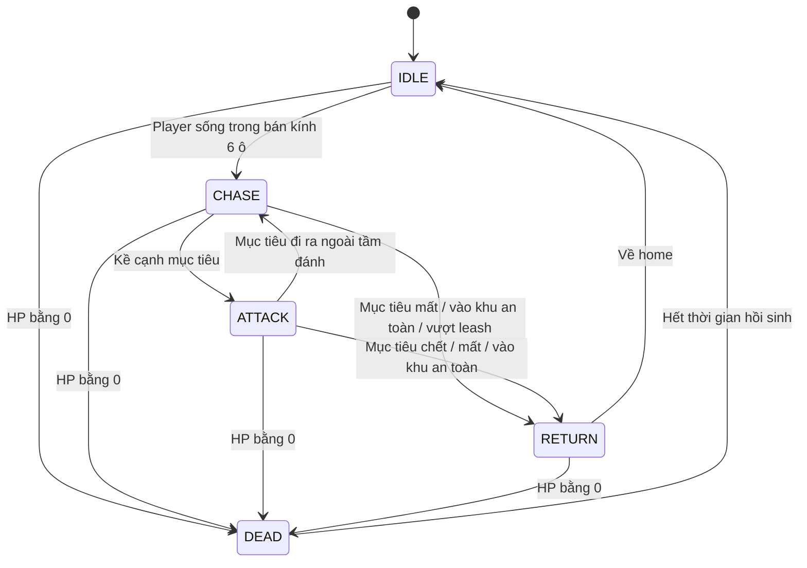
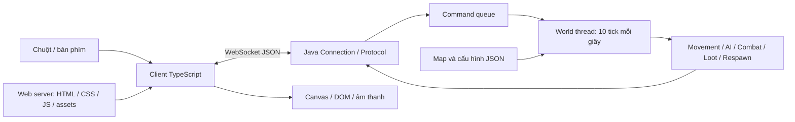

# Thiết kế game — Lữ khách

> Cập nhật 07/11/2026: mã game cũ và prototype đã được xóa theo yêu cầu. Các ghi chú bên dưới về bản port chỉ có giá trị lịch sử; repo BrowserQuest nguồn bên ngoài dự án vẫn giữ nguyên. Đây tiếp tục là thiết kế đề xuất cho game mới, chưa phải code đã triển khai.

Phiên bản: 0.1 — bản nháp để nhóm review. Ngày: 07/11/2026.

**Đây là thiết kế cho game tự xây mới trong 10 ngày, không mô tả tính năng đã hoàn thành.** Tên Lữ khách và các thông số dưới đây là đề xuất ban đầu, có thể điều chỉnh sau khi chơi thử. Mục tiêu và phân công tổng thể tại [kế hoạch 10 ngày](plan-10-days.md).

## 1. Tổng quan

Lữ khách là game nhập vai hành động 2D nhìn từ trên xuống, chơi trực tiếp trên trình duyệt. Tối đa 4 người trong phạm vi nghiệm thu cùng khám phá một bản đồ, chiến đấu với quái và nhặt bình máu. Thế giới dùng chung; mỗi người điều khiển một nhân vật, không có PvP.

Game lấy cảm hứng từ BrowserQuest về góc nhìn, click-to-move và tương tác nhiều người chơi. Nhóm tự viết client TypeScript và server Java. Bản port hiện có giữ làm tham khảo; chưa dùng nó làm bằng chứng sản phẩm mới đã hoàn thành. Không đọc design hoặc sửa repo BrowserQuest nguồn.

Mục tiêu trải nghiệm: người mới vào được game nhanh, thấy người chơi khác, hiểu cách di chuyển và đánh quái mà không cần hướng dẫn dài. Mục tiêu kỹ thuật: thể hiện kết nối hai chiều, đồng bộ trạng thái, quyền quyết định của server và xử lý đồng thời.

## 2. Phạm vi sản phẩm

| Bắt buộc trong 10 ngày | Tùy chọn sau khi phần bắt buộc ổn định | Ngoài phạm vi |
| --- | --- | --- |
| Một map, nhập tên, 4 người chơi, click-to-move, chat | Sprite chi tiết, animation nhiều frame, âm thanh | Đăng nhập, JWT, database, lưu tiến trình |
| Một loại quái, AI đơn giản, chiến đấu cận chiến | Hiệu ứng đẹp, thống kê phiên hiển thị trên UI | Nhiều map, nhiệm vụ, boss, PvP, cửa hàng |
| Chết/hồi sinh, rơi và nhặt bình máu | Thêm nội dung nếu còn thời gian sau nghiệm thu | Inventory, nâng cấp, trang bị, hosting Internet |
| Kiểm thử mạng, demo LAN, README và báo cáo | — | Streaming hình ảnh game từ server |

Game không có màn thắng bắt buộc. Mục tiêu phiên chơi là phối hợp sinh tồn và đánh quái; có thể tiếp tục khi quái hồi sinh. Không thêm điều kiện thắng hay hệ thống cấp độ ở bản đầu.

## 3. Vòng chơi và thao tác

```text
Nhập tên → vào khu an toàn → khám phá → tiếp cận quái → tấn công
                                  ↑                     ↓
                                  └── nhặt bình máu ← quái chết
Người chơi hết máu → chờ hồi sinh → trở lại khu an toàn
```

| Thao tác | Kết quả dự kiến |
| --- | --- |
| Click ô trống | Đi tới ô đó nếu có đường hợp lệ; hủy mục tiêu tấn công cũ |
| Click quái | Chọn mục tiêu, tự tiếp cận ô đứng cạnh, tự đánh khi đủ điều kiện |
| Click bình máu | Tiếp cận rồi yêu cầu nhặt; nhận được thì dùng ngay |
| Nhấn Enter | Mở ô chat; Enter lần nữa gửi, Escape đóng |
| Nút Dừng đánh hoặc Escape khi không gõ chat | Hủy mục tiêu tấn công |
| Nút Hồi sinh | Chỉ dùng khi đã chết và hết thời gian chờ |
| Nút Rời game | Đóng kết nối, về màn nhập tên |

Khi focus ô chat, thao tác bàn phím không điều khiển nhân vật. Khi chết, vẫn xem thế giới và chat, nhưng không di chuyển, đánh hoặc nhặt đồ. Lỗi thao tác hiển thị ngắn gọn, không làm treo game.

## 4. Bản đồ và quy ước tọa độ

- Một map 32 × 24 ô, tileSize 24 pixel; kích thước logic Canvas 768 × 576 pixel. Canvas co theo màn hình và giữ tỉ lệ.
- Gốc (0,0) ở góc trên trái; x tăng sang phải, y tăng xuống dưới. Server dùng tọa độ ô nguyên; client có thêm tọa độ pixel để vẽ.
- Va chạm tĩnh: 0 = đi được, 1 = bị chặn. Bốn biên map là vật cản.
- Chia thành khu an toàn, lối đi và bãi quái. Không cần cửa hoặc chuyển map.
- Khu an toàn đề xuất là hình chữ nhật x=2..7, y=2..7, có ít nhất 4 ô spawn player hợp lệ. Quái không sinh, đi vào hoặc gây sát thương trong vùng này.
- Các vùng sinh quái nằm ngoài khu an toàn, mỗi vùng phải có ô trống và đường nối với lối đi. Khi nạp map, kiểm tra kích thước, chỉ số ô, vị trí spawn và vùng an toàn.
- Người chơi được đứng cùng ô để giảm kẹt đường. Quái được phép trùng ô ở bản đầu; không làm cơ chế đẩy/chặn động. Quái và người chơi chỉ đánh khi ở hai ô kề cạnh, không đánh chéo hoặc cùng ô.

P1 tạo dữ liệu map mẫu; P3 xác thực và nạp. **Server gửi map chuẩn trong WELCOME**, client không giữ một bản collision tự sửa khác. Hình ảnh địa hình là dữ liệu hiển thị, không thay đổi luật va chạm.

```json
{
  "id": "starting-valley",
  "width": 32,
  "height": 24,
  "tileSize": 24,
  "collisions": [0, 1, 2],
  "safeZone": {"x": 2, "y": 2, "width": 6, "height": 6},
  "playerSpawns": [{"x": 3, "y": 3}, {"x": 4, "y": 3}],
  "mobSpawnZones": [{"id": "field-a", "x": 14, "y": 10, "width": 8, "height": 6, "count": 5}]
}
```

Đoạn JSON minh họa schema, không phải map hoàn chỉnh. collisions là danh sách index bị chặn, index = y × width + x. File thật cần đủ biên và ít nhất 4 playerSpawns; tổng count quái ban đầu là 5.

## 5. Di chuyển và tìm đường

1. Client đổi vị trí click trên Canvas sang ô, có tính tỉ lệ hiển thị và camera nếu bổ sung.
2. Client dùng A* bốn hướng để vẽ đường dự kiến. Nếu ô bị chặn hoặc không có đường, báo không thể tới.
3. Client gửi MOVE_TO chứa ô đích, không gửi tọa độ hiện tại hoặc toàn bộ đường để server tin theo.
4. Server kiểm tra biên, vật cản, trạng thái sống và tự tính đường trên map chuẩn. A* có chi phí mỗi bước bằng 1, heuristic Manhattan; thứ tự xét trên, phải, dưới, trái để dễ tái hiện.
5. Server lưu hàng đợi bước, thực hiện mỗi 200 ms: tốc độ player 5 ô/giây. Chỉ hoàn tất một bước mới thay tọa độ world. Không đặt player ở đích ngay khi nhận command.
6. Client vẽ theo snapshot server, nội suy giữa hai vị trí xác nhận. Bản đầu không dự đoán vị trí chính thức; đường client chỉ là chỉ báo và có thể khác khi world thay đổi.

Lệnh mới thay đường cũ từ vị trí server hiện tại. Click quái: server chọn ô kề đi được có đường ngắn nhất tới mục tiêu; hòa thì theo thứ tự trên, phải, dưới, trái. Nếu không tìm được ô tiếp cận thì trả NO_PATH. Mục tiêu đổi vị trí thì tính lại đường tối đa một lần mỗi tick; không đi chéo.

Vật phẩm không chặn đường. Nhặt đồ từ ô kề hoặc cùng ô. Client có thể giữ pendingLootId, gửi MOVE_TO tới một ô hợp lệ gần item và chỉ gửi LOOT khi snapshot xác nhận khoảng cách không quá 1. MOVE_TO mới, ATTACK, chết hoặc item biến mất phải hủy pendingLootId. Server luôn kiểm tra lại lúc nhận LOOT.

## 6. Nhân vật và chiến đấu

Các giá trị trong bảng là cấu hình khởi đầu để chơi thử, chưa phải thông số đã cân bằng.

| Thuộc tính | Player | Quái Slime |
| --- | --- | --- |
| Máu tối đa | 100 | 40 |
| Tốc độ | 5 ô/giây | 2,5 ô/giây |
| Sát thương mỗi đòn | 15 | 6 |
| Hồi chiêu | 600 ms | 1.000 ms |
| Khoảng cách đánh | Manhattan = 1 | Manhattan = 1 |
| Số lượng ban đầu | Tối đa 4 phiên | 5 con |

Server quyết định sát thương cố định ở bản đầu; chưa có chí mạng, cấp độ, giáp hay ngẫu nhiên damage. HP bị chặn trong [0,maxHp]. Player không gây damage cho player; không dùng khoảng cách xuyên vật cản để đánh.

ATTACK chỉ thiết lập mục tiêu. **Server tự phát đòn theo tick**, không có command HIT do client quyết định. Mỗi tick, CombatSystem kiểm tra người đánh/mục tiêu còn sống, thuộc world, đúng loại đối tượng, đang ở ô kề và không vi phạm khu an toàn. Hồi chiêu chỉ được cập nhật khi thực sự phát đòn. Không đánh bù nhiều đòn trong một tick sau khi server bị chậm.

Player tự đánh tới khi mục tiêu chết/mất, người chơi chết, gửi MOVE_TO hoặc gửi ATTACK với targetId=null. Ngoài tầm thì tiếp cận theo đường; trong tầm thì dừng di chuyển và đánh. Tick xử lý attack theo ID người đánh tăng dần để kết quả tái hiện được; đối tượng đã chết ở bước trước không đánh tiếp trong tick đó.

Khi quái chết: đánh dấu DEAD một lần, ngừng AI/combat, xét drop một lần, phát sự kiện và lên lịch hồi sinh. Nếu nhiều player cùng đánh, đòn làm HP về 0 được ghi nhận trong sự kiện, không có điểm thưởng hoặc quyền loot riêng. Không phát hai lần death/drop cho cùng vòng đời.

Player chết: hủy đường/mục tiêu/pending loot, giữ phiên kết nối, phát trạng thái chết. Không rơi đồ hoặc mất tiến trình vì bản đầu không có inventory. Không tự hồi máu khi đang sống; nguồn hồi máu là bình máu và hồi sinh.

## 7. Quái: sinh, AI và hồi sinh

### 7.1 Sinh ban đầu

Server đọc mobSpawnZones, liệt kê các ô đi được ngoài khu an toàn trong từng vùng rồi chọn không lặp cho lần sinh ban đầu. Nếu vùng không đủ ô cho count, báo lỗi cấu hình và không khởi động world sai. Random seed có thể cố định trong test; chế độ chơi bình thường dùng seed cấu hình hoặc ngẫu nhiên.

Mỗi con nhận ID duy nhất, spawnZoneId, vị trí home, HP và trạng thái IDLE. Không sinh dựa trên camera của client hoặc để client tự tạo quái.

### 7.2 Máy trạng thái



- Phát hiện bằng khoảng cách Manhattan không quá 6; chọn player gần nhất còn sống, ngoài vùng an toàn; hòa thì ID nhỏ hơn. Chỉ đuổi nếu có đường.
- Giữ mục tiêu hiện tại để tránh đổi qua lại. Bị player đánh thì ưu tiên người đánh gần nhất hợp lệ; chưa xây hate list nhiều mục tiêu.
- Mỗi 400 ms đi tối đa một ô; dùng A* để tránh bị kẹt tường. Không đi xuyên vùng an toàn.
- Leash: nếu vị trí quái cách home quá 10 ô hoặc mất mục tiêu hợp lệ thì RETURN. Trong RETURN không chủ động tìm/đánh mục tiêu; vẫn nhận damage.
- Về home, xóa mục tiêu, chuyển IDLE; không tự đầy máu. Bản đầu không có tuần tra ngẫu nhiên.
- Nếu không còn đường về home do cấu hình không hợp lệ, ghi log và tạm đứng; không dịch chuyển xuyên tường.

### 7.3 Hồi sinh

Quái chờ 15 giây sau khi chết, rồi trở về home, đầy HP, trạng thái IDLE và mục tiêu rỗng. Giữ cùng ID; tăng spawnGeneration để phân biệt các lần sống khi xử lý event/animation. Home là ô hợp lệ từ lúc nạp map; bản đầu cho phép đứng chung ô nên không cần trì hoãn do player chiếm ô.

Player có thể bấm Hồi sinh sau 3 giây chết. Server kiểm tra trạng thái/thời hạn, chọn một playerSpawn hợp lệ trong khu an toàn, đặt HP=100 và hủy hành động cũ. Giữ cùng ID trong phiên; vào lại sau disconnect tạo ID mới. Không có checkpoint giữa map.

## 8. Bình máu và nhặt đồ

- Chỉ có HEALTH_POTION, xuất hiện với xác suất 50% mỗi lần quái chết, tại ô quái chết. Tỉ lệ cấu hình, test dùng RNG kiểm soát được.
- Mỗi item có ID, x/y, createdTick và expiresTick; tự biến mất sau 20 giây nếu chưa nhặt.
- Item không thuộc riêng ai. Player sống, cách Manhattan không quá 1, và chưa đầy máu được nhặt.
- Bình được dùng ngay, hồi 30 HP nhưng không vượt 100; chưa có túi đồ.
- Player đầy máu nhận HP_FULL và item được giữ lại. Item đã mất hoặc hết hạn nhận ITEM_UNAVAILABLE.
- Command được xử lý tuần tự trong world thread. Hai player cùng nhặt: command hợp lệ xử lý trước xóa item ngay, command sau thất bại. Không thể hồi máu hai lần từ cùng một item.
- Nhặt xong hoặc hết hạn thì xóa khỏi world; item đã nhặt không tự hồi sinh. Chỉ có drop mới tạo item mới.

## 9. Màn hình và phản hồi

### Màn vào game

Tên nhân vật 1–15 Unicode code point sau trim, không chứa ký tự điều khiển. Tên không cần duy nhất; ID phân biệt player. Có nút Vào game, trạng thái kết nối và lỗi tên/world đầy. Không có mật khẩu.

### Màn chơi

```text
+--------------------------------------------------+
| Tên nhân vật | HP 100/100 | Online 4 | Kết nối     |
+-----------------------------------+--------------+
|                                   | Hướng dẫn    |
|            CANVAS GAME            | ngắn gọn     |
|     map, player, mob, item         | mục tiêu     |
|                                   |              |
+-----------------------------------+--------------+
| Chat gần nhất                     | Rời game     |
| [Nhập tin nhắn..................] [Gửi]           |
+--------------------------------------------------+
```

HP và mục tiêu cập nhật theo server. Tên được vẽ thành text; chat dùng textContent, không diễn giải HTML. Màu riêng/viền giúp nhận biết nhân vật của mình. Click sai có chỉ báo; đánh trúng có hiệu ứng ngắn; không cần hiệu ứng phức tạp.

Màn chết phủ thông báo và đếm ngược từ thời gian server cho biết; nút hồi sinh chỉ bật khi đủ điều kiện. Mất kết nối: khóa thao tác gameplay, hiển thị cảnh báo, nút Vào lại tạo kết nối/phiên mới; không tự giả lập world đang chạy. Có thể dùng số tick trễ/RTT trong panel debug phục vụ demo, không bắt buộc UI người chơi.

## 10. Kiến trúc và phân chia xử lý



Client giữ input, selection, UI, path preview và bản sao world để render. Server giữ trạng thái chính thức: vị trí theo tick, đường đang đi, HP, cooldown, mục tiêu, vòng đời quái/item và phiên kết nối. HTTP phục vụ file; gameplay qua WebSocket. Không truyền video/JPEG của game từ server.

WebSocket callback chỉ parse/kiểm tra đầu vào và đưa command vào queue; không sửa Entity. **Một world thread duy nhất** thực thi command và tất cả game systems. Khi disconnect, đưa command nội bộ vào cùng queue để dọn player/mục tiêu; bỏ command đã xếp hàng thuộc phiên không còn hoạt động.

Thứ tự mỗi tick 100 ms: (1) dọn session đã đóng; (2) lấy command hợp lệ theo thứ tự vào queue; (3) cập nhật ý định và AI; (4) tiến bước movement; (5) combat và xử lý chết/drop ngay; (6) loot/item hết hạn, respawn; (7) phát event và snapshot cuối tick. Chỉ command còn hợp lệ tại thời điểm thực thi được chạy. Mỗi bước hệ thống không tự mở thread riêng.

Server dùng đồng hồ đơn điệu hoặc tick cho timer. Hồi chiêu player 6 tick, quái 10 tick; bước player 2 tick, quái 4 tick; respawn mob 150 tick, player 30 tick; item sống 200 tick. Nếu world không giữ được 10 Hz, ghi log để xử lý, không chạy bù combat không giới hạn. Mốc wall-clock chỉ dùng log, không dùng dữ liệu giờ do client gửi để tính gameplay.

Client nội suy snapshot với độ trễ hiển thị mục tiêu 100 ms. Nếu thiếu snapshot mới thì giữ vị trí xác nhận gần nhất, không tự đi tiếp vô hạn. Chưa có client prediction/rollback; latency biểu hiện bằng trễ thao tác, chấp nhận trong phạm vi local/LAN.

## 11. Mô hình dữ liệu

| Model | Trường chính | Nơi sở hữu |
| --- | --- | --- |
| Session | sessionId nội bộ, connection, playerId, lastRequestId, lastSeen | Server |
| Player | id, name, x, y, hp, maxHp, state, targetId, path, nextAttackTick, respawnReadyTick | Server; client nhận các trường hiển thị |
| Mob | id, kind, x, y, hp, maxHp, state, targetId, home, spawnZoneId, spawnGeneration, timers | Server; client nhận các trường hiển thị |
| Item | id, kind, x, y, expiresTick | Server và snapshot client |
| MapData | id, width, height, tileSize, collisions, safeZone, spawn definitions | JSON server; WELCOME gửi phần cần cho client |
| WorldState | tick, players, mobs, items | Snapshot server gửi xuống client |

ID là chuỗi do server cấp, duy nhất trong vòng chạy server, ví dụ p-1, m-1, i-1. Không tái dùng ID player/item trong cùng vòng chạy. state player: IDLE/MOVING/ATTACKING/DEAD. Mob dùng state ở mục 7. Không gửi object connection, hàng đợi đường hoặc các cấu trúc nội bộ Java xuống client.

Snapshot players chứa id/name/x/y/hp/maxHp/state/targetId/respawnReadyTick; mobs chứa id/kind/x/y/hp/maxHp/state/targetId/spawnGeneration; items chứa id/kind/x/y/expiresTick. Các ID mục tiêu không có giá trị dùng null, không dùng chuỗi rỗng hoặc số 0.

## 12. Giao thức ứng dụng v1 đề xuất

> Đã chốt hợp đồng triển khai tại [protocol-v1.md](protocol-v1.md) ngày 07/11/2026, bao gồm schema chi tiết và cách chia dọc. Khi khác nhau, dùng tài liệu đó; nội dung bên dưới là bản đề xuất trước khi chốt.

Endpoint dự kiến: ws://127.0.0.1:8080/game. Chưa thay đổi endpoint hoặc giao thức của code cũ trong tài liệu này.

Mỗi command là JSON object {v:1,type,requestId,payload}. requestId là số nguyên dương tăng dần theo kết nối. Server chỉ tin playerId gắn với socket, không nhận playerId do client tự xưng. ACK chỉ có nghĩa command đã được chấp nhận ở lớp xử lý, không có nghĩa đã đi tới đích hoặc đã gây damage.

| Client command | payload | Điều kiện/tác dụng |
| --- | --- | --- |
| JOIN | {name} | Lệnh đầu, một lần mỗi socket; tạo player |
| MOVE_TO | {x,y} | Ô nguyên trong map, sống; thay đường và hủy đánh |
| ATTACK | {targetId: string hoặc null} | Quái hợp lệ; lưu mục tiêu hoặc dừng đánh |
| LOOT | {itemId} | Sống, gần item, chưa đầy HP; xử lý đúng một lần |
| CHAT | {text} | Đã JOIN; 1–120 code point sau trim, một dòng |
| RESPAWN | {} | Đã chết, qua thời gian chờ |
| PING | {nonce} | Đo RTT, không dùng timestamp client cho luật game |

```json
{"v":1,"type":"MOVE_TO","requestId":2,"payload":{"x":12,"y":8}}
```

Server event có {v:1,type,tick,payload}; ACK/ERROR thêm requestId để đối chiếu. WELCOME gồm playerId, tickDurationMs=100, map và snapshot đầu. WORLD_STATE là snapshot đầy đủ mỗi tick, gồm mọi player/mob/item của map nhỏ. Chưa tối ưu phân vùng hoặc delta.

| Server event | payload chính | Vai trò |
| --- | --- | --- |
| WELCOME | {playerId,tickDurationMs,map,state} | JOIN thành công |
| WORLD_STATE | {players,mobs,items} | Nguồn trạng thái chính thức cho client |
| ACK | {commandType} | Đã chấp nhận command; có requestId |
| ERROR | {code,message} | Từ chối command; có requestId nếu đọc được |
| CHAT | {playerId,name,text} | Tin nhắn chung |
| DAMAGE | {attackerId,targetId,amount} | Hiệu ứng đòn đánh, không tự trừ HP lần nữa |
| ENTITY_SPAWN | {id,kind,spawnGeneration?} | Hiệu ứng xuất hiện, snapshot chứa dữ liệu đầy đủ |
| ENTITY_DESPAWN | {id,reason} | Hiệu ứng chết/nhặt/hết hạn/rời game |
| PONG | {nonce} | Phản hồi đo RTT |

Snapshot là nguồn cập nhật danh sách, tọa độ và HP; spawn/despawn/damage events chỉ phục vụ hiệu ứng và thông báo, không áp lại thay đổi gameplay lên state. Player/mob DEAD có thể tiếp tục có trong snapshot để vẽ trạng thái chết; DESPAWN với reason=DEAD ẩn hình sống, không tự xóa model. Player rời game/item mất thì không còn trong snapshot kế tiếp. Gói cùng tick được xử lý theo thứ tự nhận; bỏ snapshot có tick không lớn hơn tick đã áp dụng. Event luôn phát trước snapshot tương ứng trong tick để client có dữ liệu cũ phục vụ hiệu ứng.

```json
{
  "v": 1,
  "type": "WORLD_STATE",
  "tick": 42,
  "payload": {
    "players": [{"id":"p-1","name":"An","x":12,"y":8,"hp":100,"maxHp":100,"state":"IDLE","targetId":null,"respawnReadyTick":null}],
    "mobs": [],
    "items": []
  }
}
```

Lỗi dự kiến: INVALID_MESSAGE, UNSUPPORTED_VERSION, JOIN_REQUIRED, ALREADY_JOINED, WORLD_FULL, INVALID_NAME, INVALID_TARGET, BLOCKED_TILE, NO_PATH, PLAYER_DEAD, OUT_OF_RANGE, ITEM_UNAVAILABLE, HP_FULL, RESPAWN_NOT_READY, RATE_LIMITED, STALE_REQUEST.

PING không cần JOIN; command gameplay cần JOIN. P3 phải chốt schema chi tiết/mẫu WELCOME và parser Java cùng P2 trước khi lập trình độc lập. Giao thức này thay thế giao thức mảng của bản port đối với sản phẩm mới; [protocol.md](protocol.md) hiện vẫn mô tả code port cũ.

## 13. Kết nối và xử lý dữ liệu sai

- Giới hạn 4 player đã JOIN; nếu đầy thì trả WORLD_FULL rồi đóng socket phù hợp. Giới hạn tổng socket đang chờ: 8; JOIN timeout đề xuất 5 giây.
- Command tối đa 4 KiB UTF-8, kiểm tra ở transport trước khi tích lũy không giới hạn; JSON lỗi không được làm dừng world thread.
- Queue tối đa 64 command/session; tốc độ nhận tối đa 20 command/giây/session; chat tối đa 1 tin/giây. Đây là ngưỡng cấu hình ban đầu, cần thử thực tế.
- requestId đã thấy hoặc nhỏ hơn lần trước bị STALE_REQUEST; không áp dụng lại LOOT/RESPAWN. WebSocket giữ thứ tự trên kết nối, không xây lại TCP.
- Server ghi nhận liveness theo ping/pong định kỳ 5 giây; không nhận tín hiệu sống trong 15 giây thì đóng/dọn phiên. Kiểm thử phân biệt đóng tab bình thường với mất mạng cần chờ timeout.
- Khi disconnect: xóa player, hủy đường/mục tiêu liên quan, dọn command cũ; item/quái khác tiếp tục tồn tại. Kết nối lại tạo phiên/player mới, không resume.
- Client chỉ áp dụng dữ liệu từ socket hiện tại; socket cũ không được ghi đè state của phiên mới. Nút vào game khóa trong lúc đang kết nối.

Các giới hạn là thiết kế cần hiện thực và kiểm thử; không được mô tả là tính năng đã có trong server hiện tại.

## 14. Lưu trữ và triển khai

Map và cấu hình game lưu file JSON được quản lý bằng Git. Runtime world nằm trong RAM; khởi động lại server tạo thế giới mới. Không hứa giữ trang bị/thành tích/vị trí qua các phiên. LocalStorage chỉ dùng cho tên gần nhất, âm lượng và tùy chọn UI nếu có; không dùng làm nguồn HP/damage/loot.

Chạy phát triển bằng Vite cho web và Java process riêng cho game server. Demo local/LAN, 4 trình duyệt hoặc 4 máy. Build client tạo file tĩnh; chưa triển khai cloud, TLS hoặc reverse proxy trong phạm vi bắt buộc. Chọn cổng/config qua biến cấu hình, không hardcode IP riêng trong mọi module.

## 15. Module và quyền sở hữu của 4 người

> Phân công theo tầng trong mục này đã được thay bằng [phân công chia dọc](protocol-v1.md#1-mỗi-người-làm-cả-client-và-server). Nhãn P1–P4 tại bảng nghiệm thu mục 16 cũng là nhãn cũ; tra người phụ trách tính năng theo tài liệu mới.

Đây là bố trí mục tiêu cho code mới, chưa phải thao tác di chuyển file đã thực hiện.

```text
source/client/src/
  main.ts                    # P2: ghép module
  render/ input/ pathfinding/ # P1
  network/ state/ ui/         # P2
source/server/src/main/java/<package>/
  protocol/ connection/      # P3
  world/ entity/ config/      # P3; P4 review API
  systems/                   # P4: AI, combat, spawn, loot, respawn
  movement/                  # P3
source/common/
  protocol/                  # P2+P3: JSON schema/mẫu command-event
  config/                    # Map và game config chuẩn; P1+P3 thống nhất
```

P1 nhận WorldState chỉ đọc và callback onMove/onAttack/onLoot từ P2; không trực tiếp tạo WebSocket. P2 cung cấp state giả ngay ngày 1 để P1 làm độc lập. P3 cung cấp WorldContext cho P4: tìm entity, xem map, lấy tick, thêm/xóa entity và đẩy event. P4 chạy system trên world thread, không truy cập socket hoặc sửa JSON parser. P3/P4 thống nhất constructor/model từ ngày 1, không cùng sửa một lớp server lớn.

## 16. Tiêu chí nghiệm thu thiết kế và sản phẩm

| ID | Kịch bản | Kết quả cần đạt | Chủ trì |
| --- | --- | --- | --- |
| AC01 | 4 client vào game | Mỗi client có ID riêng, cùng map và state; client thứ 5 bị từ chối | P2/P3 |
| AC02 | Click đi quanh tường | Client preview được; server không xuyên tường, không vượt 5 ô/giây | P1/P3 |
| AC03 | Gửi x/y giả hoặc MOVE dồn dập | Server không nhận vị trí tự xưng, vẫn giữ tốc độ và giới hạn queue | P3 |
| AC04 | Chọn quái ở xa | Đi tiếp cận rồi mới gây damage; không HIT tùy ý từ client | P1/P4 |
| AC05 | Spam ATTACK | Không vượt 1 đòn/600 ms, chết/drop chỉ một lần | P3/P4 |
| AC06 | Hai player cùng LOOT | Chỉ một người nhận +30 HP; người kia nhận item không còn | P4 |
| AC07 | Nhặt khi đầy HP | Item không mất, HP không vượt 100, có phản hồi | P2/P4 |
| AC08 | Quái chết/player chết | Quái hồi sinh sau 150 tick; player chờ tối thiểu 30 tick trước RESPAWN | P4 |
| AC09 | Chạy vào khu an toàn | Quái không đi vào/đánh xuyên vùng an toàn, bỏ đuổi và về home | P3/P4 |
| AC10 | Chat có HTML/ký tự lạ | Hiển thị text, không chạy HTML; giới hạn độ dài/tần suất đúng | P2/P3 |
| AC11 | Đóng tab/mất mạng | Dọn player, target, queue; timeout phù hợp, phiên mới không bị state cũ ghi đè | P2/P3 |
| AC12 | Chơi 4 client khoảng 15 phút | Không lỗi chặn chơi; ghi bug, thông số máy và log, không suy diễn thành test tải lớn | Cả nhóm |
| AC13 | Chạy từ checkout sạch | Theo README chạy được, file phụ thuộc và nguồn asset đầy đủ | P2, cả nhóm review |

Đo tick duration và RTT trên môi trường demo. Mục tiêu tick hoàn tất dưới 100 ms với tải nghiệm thu 4 client; đây là mục tiêu đo, chưa phải kết quả. Client hướng tới render 60 FPS nếu máy đáp ứng; không cam kết trên mọi thiết bị. Khi không đạt, đo điểm nghẽn trước khi thêm tối ưu phức tạp.

## 17. Quyết định cần review trước khi bắt đầu code

> Giao thức và điểm ghép module (mục 3–4 bên dưới) đã được chốt trong [protocol-v1.md](protocol-v1.md). Nhóm điền tên thật cho các vai trò và triển khai theo hợp đồng đó.

1. Chốt tên game, phong cách hình ảnh và người phụ trách P1–P4.
2. Review các thông số đề xuất ở mục 4–8; giữ một file config chuẩn cho client/server.
3. P2/P3 chốt schema protocol v1, mẫu map/snapshot/command, quy tắc tick và lỗi.
4. P3/P4 chốt WorldContext và model; P1/P2 chốt render-state/input interface.
5. Chốt nhánh/vị trí bắt đầu sản phẩm mới và cách giữ bản port cũ để tham khảo.

Thông tin chưa có: năng lực/thời gian thực tế từng người, tên chính thức, asset cụ thể, ngày bắt đầu và môi trường máy demo. Các thông số trong bản nháp là giả định để review, không giả mạo sự đồng ý của nhóm. Sau review, cập nhật phiên bản 0.2 và ghi những thay đổi ảnh hưởng module khác trước khi triển khai.
