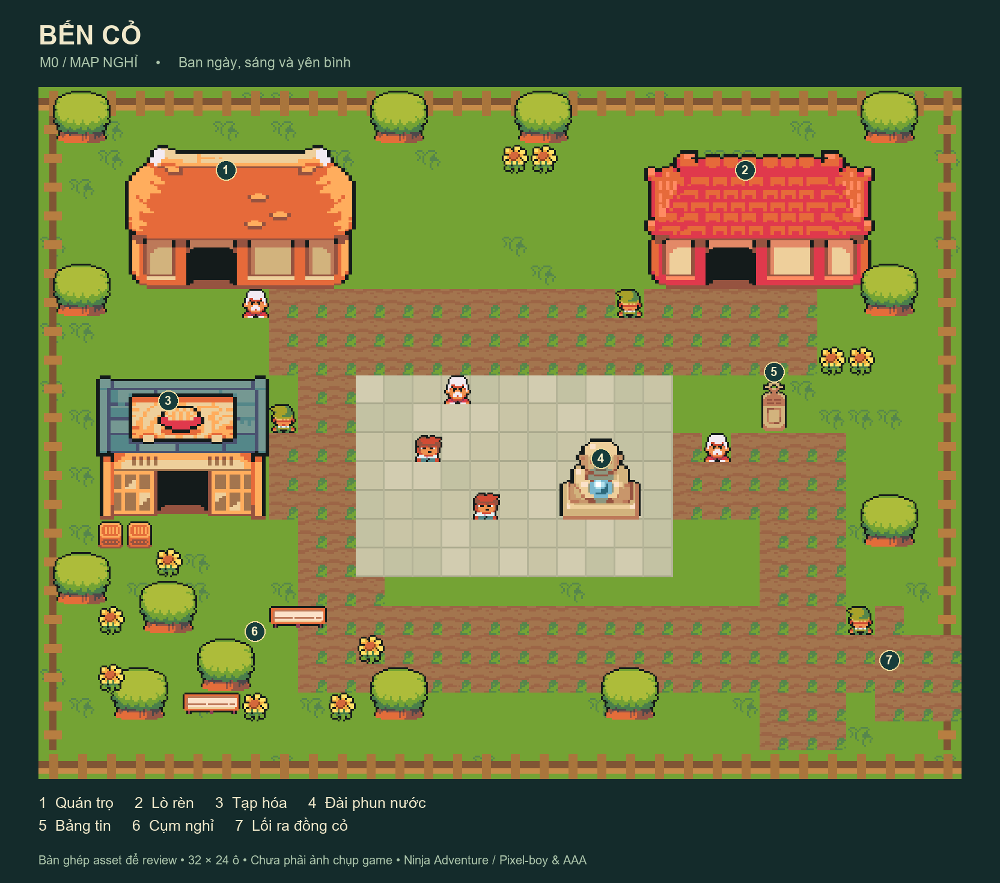
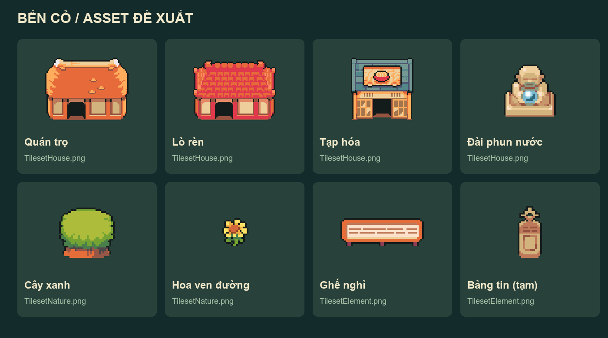

# M0 — Asset đề xuất và ảnh xem trước Bến Cỏ

Ngày: 17/11/2026. Bản ghép hình để review theo [bản phác M0](map-m0-village.md), chưa phải dữ liệu runtime hoặc ảnh chụp game.

## Asset đề xuất

Nguồn: thư mục Ninja Adventure - Asset Pack cục bộ, tác giả Pixel-boy và AAA. README và LICENSE.txt đi kèm ghi CC0. Toàn bộ đường dẫn dưới đây tính từ gốc bộ asset; tọa độ crop là pixel, dạng (left, top, right, bottom), không tính cạnh phải và dưới.

| Thành phần | File | Crop trong ảnh xem trước | Đề xuất sử dụng |
| --- | --- | --- | --- |
| Cỏ xanh | Backgrounds/Tilesets/TilesetFloor.png | (176,192,192,208), (192,192,208,208) | Nền chính, xen một ít cỏ chi tiết |
| Đường đất | Backgrounds/Tilesets/TilesetFloor.png | (256,128,272,144) | Màu nền mẫu; cần ghép đủ tile mép/corner ở bản triển khai |
| Quán trọ | Backgrounds/Tilesets/TilesetHouse.png | (0,0,64,48) | Nhà mái cam; thêm biển giường sau |
| Lò rèn | Backgrounds/Tilesets/TilesetHouse.png | (192,0,256,48) | Nhà mái đỏ; cần bổ sung đe/biển riêng để nhận ra dịch vụ |
| Tạp hóa | Backgrounds/Tilesets/TilesetHouse.png | (256,0,304,48) | Mặt tiền có biển, thêm kiện hàng |
| Đài phun nước | Backgrounds/Tilesets/TilesetHouse.png | (48,240,80,272) | Đài đá nhỏ có nước xanh, hợp màu làng; dùng ảnh tĩnh trước |
| Cây | Backgrounds/Tilesets/TilesetNature.png | (0,0,32,32) | Cây tán tròn xanh, bố trí quanh biên và cụm nghỉ |
| Hoa | Backgrounds/Tilesets/TilesetNature.png | (16,176,32,192) | Nhóm nhỏ ở mép cỏ, không rải kín đường |
| Ghế | Backgrounds/Tilesets/TilesetElement.png | (176,16,224,32) | Ghế gỗ ở góc nghỉ |
| Bảng tin tạm | Backgrounds/Tilesets/TilesetElement.png | (0,80,16,112) | Biển đứng chỉ minh họa vị trí; cần thay hoặc ghép bảng rộng có giấy thông báo |
| Kiện hàng | Backgrounds/Tilesets/TilesetElement.png | (0,0,16,16) | Trang trí cạnh tạp hóa |
| NPC và người chơi mẫu | Actor/Character/{Master,ManGreen,Boy}/SpriteSheet.png | (0,0,16,16) | Nhân vật minh họa, chưa chốt danh tính |

## Giới hạn của ảnh xem trước

- Nguồn chủ yếu theo lưới 16 px; ảnh map dựng trên lưới 32 × 24 ô ở 16 px/ô rồi phóng nguyên 3 lần. Tile logic 24 px trong tài liệu chưa thay đổi. Khi triển khai cần quyết định cách ánh xạ và scale để tránh pixel không đều.
- Nhà, đài và ghế được đổi kích thước để diễn tả diện tích dự kiến. Cần ghép công trình từ tile trước khi chốt hình ảnh cuối; không dùng hình co giãn này làm sprite runtime.
- Nền đá quảng trường và hàng rào được vẽ bằng mã làm mẫu màu/hình, không phải asset đã xác định trong pack.
- Một số cây, hoa và kiện hàng chỉ minh họa cảnh quan, chưa cập nhật thành collision trong bản phác. Footprint, vật che và lối đi phải đối chiếu lại khi dựng dữ liệu.
- Đài phun nước đang là hình tĩnh. Chưa xác nhận có animation phun nước phù hợp trong pack.
- Các số trên ảnh là chú thích review, không phải giao diện trong game.

## Tệp và cách dựng lại

- `statics/map-design/ben-co-preview.png`: bản có nhãn và chú thích.
- `statics/map-design/ben-co-map.png`: ảnh map không có nhãn.
- `statics/map-design/ben-co-assets.png`: bảng asset được chọn.
- `statics/map-design/build_preview.py`: script ghép ảnh bằng Pillow, đọc lưới từ tài liệu M0. Chạy từ repo bằng `python statics/map-design/build_preview.py --assets "đường dẫn gốc bộ asset"`.

Chưa sửa client/server hoặc đưa map vào game.
