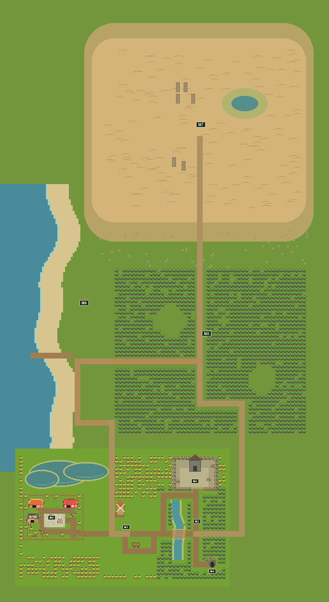
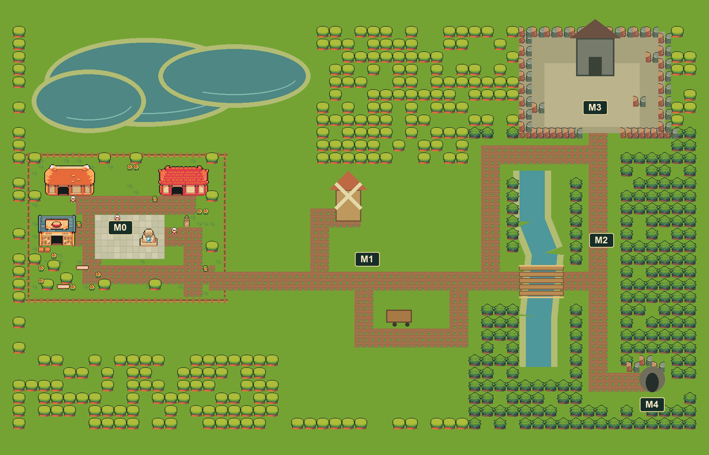

# Bố cục thế giới liền vùng — bản xem trước

## Bản hiện hành: 172 × 314 ô, tám khu M0–M7

Theo yêu cầu mới, thế giới ngoài trời dùng đúng 172 cột × 314 hàng, cùng kích thước ô với thế giới BrowserQuest về số lượng ô, không sao chép địa hình. Tile logic dự án vẫn 24 px; kích thước logic toàn thế giới tương ứng 4128 × 7536 px. M4 là nội thất riêng nên không phải toàn bộ 172 × 314 đều là các vùng chơi hoặc cùng một không gian nội thất.

Thêm M5 — Rừng Sâu (khác M2 — Rừng Qua Suối), M6 — Bờ Biển và M7 — Sa Mạc. Ba loại vùng được người dùng yêu cầu; tên chi tiết, vị trí và đường nối mới là đề xuất review. Tuyến ban đầu M0–M1–M2, nhánh M2–M3/M4 được giữ ở phía nam. Từ M2 đi bắc tới M5; M5 đi tây tới M6 hoặc đi bắc qua vùng cây thưa tới M7. Một nhánh M1–M6 tạo vòng quay về, tránh buộc mọi chuyến đi lặp toàn bộ một đường.

- M0–M3 ở miền nam; M0 có offset (12,258), giữ làng 32 × 24.
- M5 là rừng trung tâm, khoảng x=60..159, y=140..225.
- M6 trải ven biển phía tây, khoảng x=0..59, y=120..229; nước sâu không mặc định đi được/bơi được.
- M7 nằm phía bắc, khoảng x=48..159, y=20..115; phía nam có dải chuyển tiếp khô/cây thưa trước rừng.
- M4 nội thất giữ riêng, cửa hang ở nhánh nam M2.

Metadata review tại `statics/map-design/world-172x314.design.json`, ảnh gốc `world-172x314.png`. Dựng bằng `python statics/map-design/build_world_172.py`. Ảnh có địa hình minh họa và đường nối; chưa có collision toàn thế giới, quái, nhiệm vụ mới hoặc logic di chuyển/camera trong runtime. Khoảng cách dài cần kiểm tra nhịp di chuyển khi dựng từng khu; chưa coi toàn bộ diện tích là nội dung đã hoàn thiện.

## Bản trước: 112 × 72 ô (lưu tham khảo)

Ngày: 17/11/2026. Phác thảo để review, chưa thay runtime M0 hoặc tạo collision cho thế giới. Tiếp nối [map v2](map-system-v2.md).

Đề xuất miền ngoài trời 112 × 72 ô: M0 ở phía tây, M1 nối sang phía đông, M2 là rừng ở phía đông đồng cỏ, M3 phía bắc rừng. M4 có cửa ở phía nam rừng nhưng nội thất là không gian riêng. Kích thước và vị trí là đề xuất mới, không phải thông số đã chốt hoặc đã kiểm thử gameplay.

M0 hiện được đặt tại offset (4,24), giữ bố cục 32 × 24. Lối đông ở khoảng thế giới (35,43..45) nối đường đồng cỏ, đường chính đi tới cầu trong rừng ở khoảng (85,44). Đường nhánh phía bắc vòng qua đầu suối tại y≈24. Sau cầu, hướng bắc dẫn vào trạm qua cạnh nam; hướng nam tới cửa hang. Đường vòng nam đồng cỏ nối lại trước bìa rừng.

Hồ phía tây bắc và các cụm rừng ngoài tuyến chỉ là gợi ý cảnh quan biên, chưa bổ sung vùng chơi hoặc nhiệm vụ. Cối xay, xe hàng, tháp canh và hang trong ảnh là hình khối minh họa; các tile Ninja Adventure được dùng cho làng và một phần cảnh quan. Nội thất hang là sơ đồ phòng/hành lang, chưa phải tile art cuối.

Một viewport mẫu 32 × 24 ô có thể được dịch qua thế giới; các khung cắt xem gần không phải giới hạn của mỗi vùng M0–M3. Đường và khoảng trống chỉ được bố trí hình ảnh để trao đổi, chưa có kiểm tra A*, AI, safe-zone, spawn quái hay chuyển nội thất. Sẽ dựng tile/collision chi tiết sau review bố cục.

Ảnh tái tạo bằng `python statics/map-design/build_world_preview.py`. Không dùng script này để thay dữ liệu map runtime.
