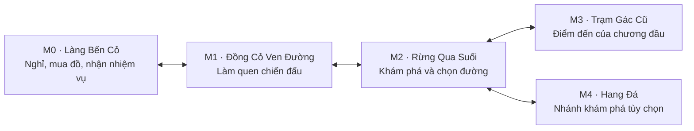

# Hệ thống map — Lữ khách

Ngày: 13/11/2026. Đây là thiết kế nội dung, chỉ viết tài liệu. Map nghỉ không có quái, người bán đồ, NPC hướng dẫn rải rác và bảng tin nhận nhiệm vụ/xem thành tựu là các yêu cầu đã xác nhận. **Tên, số lượng, kích thước, quái, nhiệm vụ và kết nối map trong tài liệu này là đề xuất mới.**

Thiết kế tiếp nối [cốt truyện và map nghỉ](story-and-map.md), độc lập với Miền Quên. Tham khảo BrowserQuest ở cách phân vùng cảnh quan, đặt mốc khám phá, NPC và đường đi; không sao chép nguyên bản đồ. Chưa cập nhật giao thức hay triển khai chuyển map.

## 1. Quy mô thế giới đề xuất

Đề xuất năm map: một làng nghỉ, ba vùng trên tuyến khám phá chính và một nhánh phụ. Như vậy có đủ cảm giác đi xa, khám phá và quay về mà chưa cần một thế giới quá lớn. Thiết kế đầy đủ không đồng nghĩa phải triển khai cả năm map trong đợt đầu.



Mỗi cạnh là một cặp lối đi hai chiều. Không có dịch chuyển nhanh, cửa một chiều hoặc đường tắt phải mở bằng nhiệm vụ trong đề xuất ban đầu. Người chơi luôn có thể quay về làng theo đường đã đi.

| ID | Tên tạm | Kích thước | Nhịp trải nghiệm | Mốc nhận diện |
| --- | --- | --- | --- | --- |
| M0 | Làng Bến Cỏ | 172 × 314 ô | An toàn, chuẩn bị, gặp nhau | Quảng trường và bảng tin |
| M1 | Đồng Cỏ Ven Đường | 172 × 314 ô | Thoáng, dễ định hướng | Cối xay gió và xe hàng dừng bên đường |
| M2 | Rừng Qua Suối | 172 × 314 ô | Nhiều lối, khám phá thận trọng | Cầu gỗ và cây cổ thụ |
| M3 | Trạm Gác Cũ | 172 × 314 ô | Tiếp cận mục tiêu, giao tranh tập trung | Tháp canh và sân trạm |
| M4 | Hang Đá | 172 × 314 ô | Tùy chọn, đường hẹp xen phòng rộng | Cửa hang và khoang đá lớn |

Mỗi map dùng tileSize logic 24, tương ứng 4128 × 7536 pixel trong thế giới logic. Canvas hiển thị một khung nhìn có camera, không render toàn bộ map cùng lúc. Các map là khu vực riêng nối với nhau theo sơ đồ phía trên.

## 2. Cốt truyện nối các map

Làng Bến Cỏ sống nhờ tuyến đường đi qua đồng cỏ, rừng và trạm gác. Gần đây đường ít người qua vì sinh vật hoang tập trung quanh những đoạn bị bỏ mặc. Người chơi là các lữ khách mới đến, nhận các công việc nhỏ tại bảng tin rồi dần đi xa hơn để tìm hiểu tình hình.

Chương đầu đề xuất kết thúc bằng việc người chơi tới được Trạm Gác Cũ và tìm hiểu vì sao nơi này ngừng hoạt động. Chưa chốt nguyên nhân hoặc phản diện. Không mặc định mọi hiện tượng đều do một boss điều khiển.

Mạch nhiệm vụ gợi ý: làm quen làng → khảo sát đường đồng cỏ → tìm mốc đường trong rừng → kiểm tra trạm gác. Hang Đá là chuyến đi phụ, không bắt buộc để đi tới trạm. Nhiệm vụ dẫn đường nhưng không khóa vật lý các map theo tiến trình cá nhân.

## 3. M0 — Làng Bến Cỏ

Bản phác lưới khu vực lõi 32 × 24 ô, footprint công trình, vị trí NPC và cổng nằm tại [map-m0-village.md](map-m0-village.md); đây là một phần của map M0 172 × 314 ô, không phải toàn bộ map.

**Vai trò:** map xuất hiện và trở về, toàn bộ an toàn. Bố cục chi tiết đang nằm tại [story-and-map.md](story-and-map.md).

- Quảng trường trung tâm có bốn điểm xuất hiện và khoảng đứng chung.
- Tạp hóa ở phía tây, quán trọ ở tây bắc, lò rèn ở đông bắc.
- Bảng tin phía đông quảng trường: hai mục nhiệm vụ và thành tựu, tiến trình theo từng người.
- NPC hướng dẫn ở quảng trường, gần dịch vụ, bảng tin và cổng; mỗi người giải thích phần liên quan.
- Cổng đông nam nối với lối vào phía tây M1. Cổng được biểu diễn thành một đoạn đường ra khỏi làng, không cần hình cổng phép.
- Cây và ghế nghỉ bố trí thành cụm nhỏ ở khoảng trống; vườn không có chức năng hồi máu riêng và chưa cần chiếm một khu lớn.

Không có quái, PvP, bẫy, sát thương môi trường hoặc sự kiện tấn công làng. Hồi máu tại quán trọ, bán đồ và lò rèn cần luật riêng, không mặc định hoàn thiện chỉ vì đã có vị trí trên map.

**Nhiệm vụ gợi ý:** ghé người bán đồ và bảng tin; không bắt buộc mua hàng để hoàn thành hướng dẫn khi chưa chốt tiền ban đầu. **Thành tựu gợi ý:** tìm đủ các dịch vụ cơ bản.

## 4. M1 — Đồng Cỏ Ven Đường

**Vai trò:** map chiến đấu đầu tiên, người mới nhìn được đường về và có khoảng trống để học tiếp cận quái.

```text
                 [Cối xay / bãi cỏ]
                         │
Làng ← [Lối vào] ═══ [Ngã đường] ═══ [Lối sang rừng] → M2
                         │                   │
                 [Xe hàng / NPC] ── [Đường vòng nam]
```

- Đường đất chính chạy từ tây sang đông, rộng ít nhất ba ô. Phần giữa không có vật cản che tầm nhìn.
- Cối xay phía bắc là mốc dễ nhớ; bãi slime đặt bên đường phía bắc và đông nam, không ngay tại ô đến.
- Xe hàng dừng ở phía nam ngã đường, có NPC người vận chuyển chỉ đường và kể chuyện ngắn. Xe chỉ là địa điểm tĩnh; chưa có hộ tống xe.
- Đường vòng phía nam nối lại tuyến chính trước cửa rừng. Người chơi có thể quan sát rồi tránh bãi quái, không phải đánh hết mới đi tiếp.
- Hàng rào thấp, cây thành cụm và bờ đất tạo biên; không đặt nước sâu hoặc vực gây hiểu nhầm là đi được.

**Quái đề xuất:** slime, hai bãi, tổng năm con để bắt đầu cân bằng. Quái không sinh hoặc đuổi vào khu đệm lối chuyển map và khoảng tương tác của NPC. Không gọi toàn bộ đường chính là vùng an toàn.

**Nhiệm vụ gợi ý:** khảo sát cối xay và nói chuyện với người vận chuyển; một công việc riêng có thể yêu cầu đánh slime. **Thành tựu gợi ý:** lần đầu ra khỏi làng, lần đầu đánh bại quái. Chưa chốt số lượng hoặc phần thưởng.

## 5. M2 — Rừng Qua Suối

**Vai trò:** mở rộng lựa chọn đường đi và dẫn tới hai đích khác nhau.

```text
                   [Lối vòng phía bắc] ─────────┐
                          │                    │
M1 ← [Bìa rừng] ─── [Cầu qua suối] ─── [Ngã ba / cây cổ thụ] → M3
                          │                    │
                    [Bãi ven suối]        [Đường tới hang]
                                               ↓
                                              M4
```

- Lối vào phía tây, đường tới trạm gác ở phía đông, cửa hang ở phía nam.
- Suối chỉ cắt phần giữa map, có cầu rộng ít nhất ba ô và đường vòng phía bắc qua đầu suối. Tránh vẽ suối kéo kín map khiến đường vòng không tồn tại.
- Cây cổ thụ cạnh ngã ba và biển chỉ hướng giúp phân biệt đường chính tới trạm với nhánh vào hang.
- NPC người đi rừng đứng ở khoảng đất thoáng gần ngã ba; giới thiệu hai hướng và cảnh báo đường hang hẹp.
- Cụm cây tạo các khoảng chiến đấu, không che lấp người chơi hoặc lối ra. Nhánh cụt chỉ nên ngắn, có mốc đáng xem, không biến map thành mê cung.

**Quái đề xuất:** dùng slime trước; hai đến ba cụm với tổng khoảng sáu con là thông số thử, không phải số đã cân bằng. Chưa cần thêm loài quái hoặc tăng chỉ số để khiến rừng khác đồng cỏ; địa hình và khoảng cách rút lui đã tạo trải nghiệm khác.

**Nhiệm vụ gợi ý:** kiểm tra biển đường gần cầu và tìm người đi rừng trước khi tới trạm. **Thành tựu gợi ý:** tìm cả đường cầu và lối vòng. Hoạt động khám phá nên ghi nhận điểm đã ghé, không chỉ đứng ở bất kỳ ô nào trong map.

## 6. M3 — Trạm Gác Cũ

**Vai trò:** đích đến rõ ràng của hành trình đầu, có cấu trúc tập trung hơn hai map trước.

```text
                         [Tháp canh]
                              │
M2 ← [Đường vào] ─ [Sân ngoài] ─ [Sân trạm / mốc khảo sát]
                         └──── [Lối đi bên hông] ────┘
```

- Lối đến từ phía tây. Tường đổ, kho nhỏ và tháp canh tạo hình trạm từng có người dùng.
- Sân ngoài rộng để tập hợp. Hai đường vào sân trong: lối trực diện và lối bên hông, tránh một cổ chai bắt buộc.
- Mốc khảo sát có thể là bảng trực cũ hoặc dấu hiệu bỏ trạm. Nội dung phát hiện cần viết sau khi chốt cốt truyện; chưa kết luận đó là thư bí mật hoặc bằng chứng về phản diện.
- Không bắt buộc thêm NPC ở một nơi đang bỏ hoang. Người chơi nhận chỉ dẫn trước tại rừng, quay về bảng tin làng để xem tiến trình.
- Quái tập trung ở sân và quanh kho, không chặn ô chuyển map. Đề xuất dùng bốn đến sáu slime cho bản thử; chưa có boss hoặc trận đánh khóa cửa.

**Nhiệm vụ gợi ý:** tới sân trạm và kiểm tra mốc khảo sát. Nếu muốn buộc chiến đấu trước khi kiểm tra, phải thiết kế điều kiện riêng; chưa mặc định người tới sau phải chờ quái hồi sinh hoặc giết đủ một đợt dùng chung.

**Thành tựu gợi ý:** lần đầu tới trạm. Hoàn thành chặng truyện không làm biến mất quái hay sửa lại trạm với toàn bộ người chơi. Nơi trả nhiệm vụ và kết quả câu chuyện còn cần chốt.

## 7. M4 — Hang Đá

**Vai trò:** nhánh khám phá tùy chọn để thay đổi không gian; chưa phải dungeon riêng của tổ đội.

```text
M2 ↔ [Cửa hang / khoảng đệm] ─ [Khoang đầu]
                                     │
                               [Ngã rẽ]
                                /    \
                    [Lối vòng]        [Khoang đá lớn]
                                \    /
                              [Mốc khám phá]
```

- Chỉ có một cửa nối về rừng; phía trong có vòng nhỏ nối hai nhánh, không có cửa thoát một chiều.
- Hành lang rộng ít nhất hai ô; khoang chiến đấu khoảng 6 × 6 ô đi được trở lên, tùy hình dạng vật cản.
- Đá chắn đường đọc rõ trên nền tối; không dùng bóng tối che mất lối đi hoặc buộc phải có đuốc khi chưa có hệ chiếu sáng.
- Mốc khám phá là vỉa đá có hình đặc biệt hoặc khu đồ dùng cũ; không mặc định thêm khai khoáng, rương ngẫu nhiên hay vật phẩm nhiệm vụ.
- Không đặt NPC bán đồ trong hang. Dùng biển cảnh báo và NPC ở ngã ba rừng để giới thiệu nhánh này.

**Quái đề xuất:** một đến hai cụm slime, khoảng bốn con. Loài mới và phần thưởng hiếm để sau; không cam kết hang phải mạnh hơn mọi map khác. **Nhiệm vụ gợi ý:** khảo sát khoang đá, tùy chọn. **Thành tựu gợi ý:** lần đầu đi hết nhánh hang.

## 8. Quy tắc nối map và bảo vệ người chơi

- Mỗi lối đi có đích đến và lối quay về tương ứng; đến map mới đứng lệch khỏi ô kích hoạt để không chuyển ngược ngay lập tức. Ô kích hoạt chính xác chốt trong bản phác ô.
- Đề xuất khoảng đệm an toàn sâu ít nhất ba ô từ điểm đến; cần kiểm tra lại với tầm đánh và AI. Không sinh quái, chọn mục tiêu hoặc gây sát thương trong khoảng đệm. NPC hướng dẫn ngoài làng cũng có vùng tương tác được bảo vệ.
- Quái không chuyển map theo người chơi. Rời map hủy mục tiêu/đường đang đi có liên quan tới map cũ; luật AI quay về cần thống nhất khi triển khai.
- Toàn bộ map ngoài làng dùng chung giữa người chơi, không tạo bản riêng theo nhiệm vụ. NPC và đường ra không bị khóa bởi tiến trình của người khác.
- Không đặt cửa bắt buộc cấp độ hoặc nhiệm vụ ở bản thiết kế đầu. Biển/NPC cảnh báo thay cho việc tự thêm hệ cấp độ.
- Đề xuất chết ở map ngoài làng thì hồi sinh về M0 theo thời gian chờ đã định. Chưa thêm điểm hồi sinh, mất đồ, mất tiền hay dịch chuyển nhanh.
- Người chơi cần nhìn được tên vùng đang đứng và hướng quay về; cách hiển thị trên UI thiết kế sau.

## 9. Liên kết với bảng tin và thành tựu

| Map | Công việc gợi ý tại bảng tin | Cột mốc gợi ý | Dữ liệu cần chốt sau |
| --- | --- | --- | --- |
| M0 | Làm quen dịch vụ | Đã ghé các dịch vụ | NPC nào tính, có cần nói chuyện không |
| M1 | Khảo sát đường đồng cỏ | Rời làng / thắng trận đầu | Điểm khảo sát, quy tắc ghi nhận đánh quái |
| M2 | Kiểm tra đường qua rừng | Khám phá hai lối qua suối | Điểm kiểm tra của từng lối |
| M3 | Kiểm tra trạm gác | Tới trạm lần đầu | Điều kiện tương tác, nội dung phát hiện |
| M4 | Khảo sát hang, tùy chọn | Tìm khoang đá lớn | Mốc hoàn thành, có cần quay về báo cáo không |

Danh sách này chỉ gợi ý nội dung gắn với không gian. Không đặt trước giá thưởng, số điểm thành tựu hoặc điều kiện lưu lâu dài. Tránh bắt người chơi phải nhận nhiệm vụ mới được ghi nhận một thành tựu khám phá; đây là đề xuất cần chốt cùng luật tiến trình.

## 10. Thứ tự dựng thiết kế chi tiết

1. Phác từng ô M0, xác định footprint nhà, vị trí NPC, bảng tin, điểm sinh và lối ra.
2. Phác M1 và cặp chuyển M0–M1; xác minh vòng đi ra–chiến đấu–quay về trước khi tăng nội dung.
3. Phác M2, xác minh cầu và đường vòng, đặt biển phân nhánh.
4. Phác M3 để hoàn thiện tuyến khám phá đầu.
5. Phác M4 nếu tuyến chính đã rõ và còn phạm vi triển khai.

Khi phác từng ô phải ghi lớp nền, vật cản, vật che phía trên, ô tương tác, vùng an toàn, vùng sinh quái và điểm chuyển map. Ký hiệu địa hình không thay thế dữ liệu collision; mọi điểm chức năng phải có đường tới.

## 11. Kiểm tra thiết kế và những quyết định còn mở

Các tiêu chí cần kiểm tra ở bước dữ liệu/chơi thử, chưa phải kết quả đã đo:

- Từ mỗi điểm đến tìm được đường tới lối ra và mốc chính, không có ô đi được bị cô lập.
- Bốn người có thể tập hợp ở quảng trường, qua lối nối và đứng gần NPC mà không nghẽn đường.
- Map nghỉ giữ an toàn tuyệt đối; quái không gây sát thương qua ranh giới hoặc vào khoảng NPC được bảo vệ.
- Mỗi map có mốc riêng, đường chính rõ và nhánh phụ có mục đích.
- Một người hoàn thành nhiệm vụ không đổi địa hình hay đóng đường của người khác.
- Không giả định code hiện có hỗ trợ nhiều map, cửa hàng, inventory, nhiệm vụ, thành tựu hay camera.

Cần trao đổi để chốt: có giữ cả năm map hay giảm còn M0–M1 trước; kích thước; loại và mật độ quái; phát hiện tại trạm; nhiệm vụ và phần thưởng; lưu tiến trình. Các map chiến đấu là mở rộng so với phạm vi cũ và cần cập nhật thiết kế hệ thống trước khi lập trình. Trên nhánh này chưa tạo dữ liệu map hoặc thay đổi mã nguồn.
